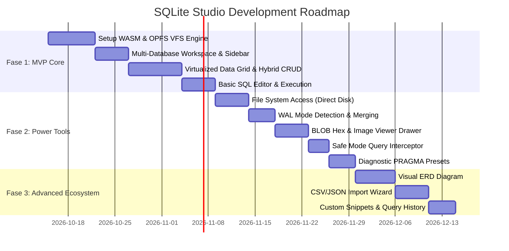

# Product Requirement Document (PRD)
# SQLite Studio — Local-First SQLite Database Manager

- **Document Version:** 1.0 (Final Draft)
- **Author:** Rizal Ahmad & Antigravity AI
- **Status:** Approved / Ready for Implementation
- **Platform:** Modern Web Browser (PWA) / Desktop-Ready (Electron / Tauri compatible)
- **Core Principles:** 100% Client-Side Privacy, Zero Server Roundtrip, Multi-Database, High-Performance VFS, Intuitive Hybrid CRUD

---

## 1. Executive Summary & Vision

**SQLite Studio** adalah platform manajemen database SQLite modern berbasis *local-first* yang berjalan sepenuhnya di browser pengguna tanpa perantara backend server. Seluruh parsing binary SQLite, eksekusi query SQL, dan operasi manipulasi data (CRUD) dijalankan di sisi klien menggunakan **Official SQLite WebAssembly (@sqlite.org/sqlite-wasm)**.

Aplikasi ini memecahkan dilema umum pengembang: aplikasi desktop tradisional (seperti DBeaver / DataGrip) terlalu berat dan lambat dibuka hanya untuk melihat/mengedit database kecil-menengah, sementara tool web online mengharuskan upload file ke server luar yang membahayakan privasi dan keamanan data sensitif.

### Nilai Utama (Key Value Proposition)
1. **Total Privacy & Zero Data Leakage:** Database tidak pernah meninggalkan memori atau disk lokal perangkat pengguna.
2. **Dual-Mode Persistence:** Mendukung **Direct Disk Sync** (menulis langsung ke file asli di komputer via File System Access API) serta mode **Browser Sandbox (OPFS)** dengan tombol Export/Download instan.
3. **Skalabilitas Database Besar (500MB - GBs):** Menggunakan SQLite WASM dengan Origin Private File System (OPFS) Virtual File System (VFS) untuk menghindari masalah *Out of Memory*.
4. **Multi-Database Workspace:** Membuka, mengelola, dan berpindah antar banyak file database SQLite secara simultan dalam satu jendela.
5. **Hybrid CRUD UX:** Menggabungkan kecepatan *inline cell editing* ala spreadsheet untuk field ringkas dengan *Side Drawer / Modal* untuk data kompleks (JSON, teks panjang, BLOB).
6. **Robust WAL Support:** Mampu mengenali dan menggabungkan file pendamping `.db-wal` dan `.db-shm` untuk mencegah data hilang atau korup.

---

## 2. Target User & Use Cases

| Persona | Kebutuhan Utama | Contoh Kasus Penggunaan |
| :--- | :--- | :--- |
| **Mobile & Web Developers** | Inspeksi dan modifikasi database lokal aplikasi secara cepat tanpa setup berat. | Menginspeksi database SQLite dari emulator Android, iOS CoreData/Room/SQLite, staging cache, atau offline sync. |
| **Data Engineers / Analysts** | Menjelajahi dataset SQLite hasil scraping atau pipeline data. | Mengeksplorasi file dataset Kaggle/scraping berukuran 200MB - 1GB, mengecek schema, dan mengekspor subset ke CSV/JSON. |
| **QA Engineers / Testers** | Memanipulasi state record database untuk pengujian fitur aplikasi. | Mengubah status pembayaran user, reset flag kuota, seeding data dummy, atau verifikasi integritas data. |

---

## 3. Arsitektur Teknis (Local-First Architecture)

```
┌─────────────────────────────────────────────────────────────────────────────────┐
│                           UI Layer (Main Thread)                                │
│   • Sidebar Workspace (Multi-DB Switcher, File Size, Dirty Indicators)          │
│   • Data Grid (Virtualized scrolling, inline cell editing, multi-filter)        │
│   • Detail Drawer (JSON Editor, Markdown/Long Text, Hex/Image BLOB Viewer)      │
│   • Monaco / CodeMirror SQL Editor (IntelliSense, Multi-tab, Execution Stats)   │
└────────────────────────────────────────┬────────────────────────────────────────┘
                                         │ Comlink / Web Worker RPC
┌────────────────────────────────────────▼────────────────────────────────────────┐
│                      SQLite Execution Worker (Dedicated)                        │
│   • Official @sqlite.org/sqlite-wasm Engine                                     │
│   • Transaction Safety Wrap (Auto-Rollback on Visual CRUD Failure)              │
│   • AST Safe Query Guard (Peringatan destruktif UPDATE/DELETE tanpa WHERE)      │
└────────────────────────────────────────┬────────────────────────────────────────┘
                                         │ VFS Interface
┌────────────────────────────────────────▼────────────────────────────────────────┐
│                        Local Storage & Persistence Layer                        │
│                                                                                 │
│   [Mode A: Direct Disk Sync]                 [Mode B: OPFS Sandbox]             │
│   • File System Access API                   • Origin Private File System       │
│   • Menulis perubahan langsung ke            • Block-based on-demand paging     │
│     file asli di harddisk komputer           • Export/Download file .db baru    │
│                                                                                 │
│   [State & Metadata Storage]                                                    │
│   • IndexedDB / LocalStorage: Saved query snippets, alias name, visual config   │
└─────────────────────────────────────────────────────────────────────────────────┘
```

### Komponen Arsitektur:
- **Engine Core:** `@sqlite.org/sqlite-wasm` dijalankan di dalam Web Worker terpisah agar eksekusi query berat tidak membekukan (freeze) antarmuka pengguna (UI).
- **VFS Driver (Virtual File System):**
  - **OPFS (Origin Private File System):** Membaca database berukuran 500MB - GBs secara *block-by-block*, hanya memuat page yang sedang dibaca ke RAM.
  - **File System Access API (`FileSystemFileHandle`):** Digunakan pada browser Chromium (Chrome, Edge, Opera) untuk membaca dan menulis perubahan secara langsung ke file fisik di disk komputer tanpa perlu download ulang.
- **Data Virtualization:** Menggunakan virtual scrolling pada tabel data untuk merender jutaan baris dengan framerate stabil 60 FPS.

---

## 4. Kebutuhan Fungsional & Spesifikasi Fitur

### 4.1 Multi-Database Workspace Management
- **Multi-File Upload:** Pengguna dapat mengunggah beberapa file `.db`, `.sqlite`, `.sqlite3` sekaligus via drag-and-drop atau file picker.
- **Folder / Companion Drop:** Jika pengguna men-drop folder atau memilih file `.db` bersama `.db-wal` dan `.db-shm`, sistem otomatis mengelompokkannya ke dalam satu database workspace.
- **Sidebar Catalog:**
  - Menampilkan daftar semua database yang aktif.
  - Informasi per database: Nama file, ukuran disk, jumlah tabel, mode penyimpanan (`Direct Sync` atau `Sandbox`).
  - Indikator Status Perubahan (*Dirty State*): Titik oranye atau teks `Unsaved Changes` jika terdapat modifikasi yang belum di-commit/download.
- **Database Context Switching:** Berganti database aktif dalam 1 klik instan tanpa refresh halaman.
- **Database Alias & Tag Warna:** Memberikan nama panggilan custom (misal: "Staging Backup", "Dev Local") dan label warna untuk mencegah kesalahan eksekusi.
- **Close & Unload:** Kemampuan menutup database dari memori dengan opsi konfirmasi simpan jika ada perubahan yang tertunda.

### 4.2 Visual Data Grid & Hybrid CRUD UX
- **Data Grid Virtualized:**
  - Rendering kolom dan baris dinamis dengan pagination (50, 100, 500, 1000 rows) atau continuous virtual scroll.
  - Kolom Primary Key (PK) ditandai dengan ikon kunci emas.
- **Inline Cell Editing (Quick Edit):**
  - Klik dua kali (double click) pada cell bertipe sederhana (angka, teks pendek, boolean, tanggal) untuk langsung mengedit nilai di tempat.
  - Tombol pintas keyboard: `Enter` untuk menyimpan, `Esc` untuk membatalkan, tombol panah/`Tab` untuk navigasi antar cell.
- **Side Detail Drawer / Modal (Complex Edit):**
  - Untuk kolom bertipe teks panjang, JSON, atau BLOB, klik ikon expand membuka Side Drawer di sisi kanan.
  - **JSON Viewer / Formatter:** Format JSON otomatis dengan syntax highlighting dan validasi sintaks sebelum disimpan.
  - **BLOB / Media Viewer:**
    - Preview gambar langsung jika format data berupa JPEG, PNG, GIF, WebP, atau SVG.
    - **Hex Viewer:** Tampilan byte heksadesimal dengan opsi upload file binary baru atau download isi binary per cell.
- **Add New Record (Insert):**
  - Tombol "+ Add Row" membuka form drawer atau row kosong di bagian atas/bawah tabel.
  - Auto-increment primary key otomatis diberi label `(Auto Generated)`.
  - Tombol eksplisit untuk `Set NULL` dan `Empty String ("")`.
- **Delete Record:**
  - Checkbox per baris untuk multi-select.
  - Tombol "Delete Selected (N)" dengan modal konfirmasi peringatan dan ringkasan primary key yang akan dihapus.
- **Filter & Sort Visual (No-Code):**
  - Filter bar per kolom dengan operator: `Equals`, `Contains`, `Starts with`, `>`, `<`, `BETWEEN`, `IS NULL`, `IS NOT NULL`.
  - Multi-column sort dengan klik header (ASC, DESC, Clear).

### 4.3 Advanced SQL Editor
- **Monaco / CodeMirror 6 Editor:**
  - Syntax highlighting resmi SQLite.
  - Autocomplete cerdas (IntelliSense) mendeteksi nama tabel dan nama kolom dari database yang sedang aktif.
  - Format SQL otomatis (Prettify SQL).
- **Tabbed Query Workspace:** Mendukung banyak tab query yang independen per database.
- **Eksekusi Fleksibel:**
  - Eksekusi semua query via `Cmd/Ctrl + Enter`.
  - Eksekusi hanya baris atau blok teks yang sedang diseleksi.
  - Tombol `Cancel Query` untuk memutus eksekusi query yang memakan waktu terlalu lama (running query worker cancellation).
- **Query Execution Statistics:**
  - Menampilkan durasi eksekusi dalam milidetik (misal: `Execution time: 14.2ms`).
  - Menampilkan jumlah baris yang dihasilkan (*Rows returned*) atau baris yang termodifikasi (*Rows affected*).
- **Explain Query Plan Visual:**
  - Menampilkan hierarki analisis query plan dari SQLite (`EXPLAIN QUERY PLAN ...`) untuk mendeteksi apakah query memanfaatkan `INDEX` atau melakukan `SCAN TABLE` yang lambat.

### 4.4 Preset & Diagnostic Tools (PRAGMA Tools)
- **Preset CRUD Otomatis:**
  - Klik kanan pada nama tabel di sidebar menyediakan menu cepat:
    - *Select Top 100 Rows*
    - *Count Total Rows*
    - *Generate INSERT Statement Template*
    - *Generate UPDATE Statement Template*
- **Preset Diagnostik & Pemeliharaan SQLite:**
  - `PRAGMA integrity_check`: Memeriksa apakah ada halaman korup pada file database.
  - `VACUUM`: Membersihkan ruang kosong yang tidak terpakai dan mengompres ukuran file database ke ukuran optimal.
  - `PRAGMA foreign_key_check`: Memindai baris-baris data yang melanggar constraint relasi tabel.
  - `PRAGMA table_info(name)`: Menampilkan rincian skema, tipe data, dan default values.
  - `PRAGMA optimize`: Menganalisis indeks dan memperbarui statistik query planner.
- **Custom User Presets (Snippets):** Pengguna dapat menyimpan query favorit ke dalam folder snippet lokal yang tersimpan di browser untuk digunakan kembali kapan saja.

### 4.5 Schema & DDL Viewer
- **Struktur Kolom & Indeks:** Inspeksi definisi tabel, tipe kolom, Primary Key, Foreign Key target, Default Value, dan constraint `NOT NULL` / `CHECK`.
- **Export DDL:** Menampilkan script asli `CREATE TABLE ...` dan `CREATE INDEX ...` dengan tombol copy 1-klik.

### 4.6 Import & Export Engine
- **Export Database File:** Download database yang telah diedit sebagai file binary `.db` murni.
- **Export Data Tabel / Query:** Export hasil data ke format CSV, JSON, atau skrip SQL `INSERT INTO ...`.
- **Import Data (CSV / JSON):**
  - Wizard import data dengan pemetaan kolom visual (column mapping).
  - Opsi: Masukkan ke tabel yang sudah ada (*Append / Replace*) atau buat tabel baru secara otomatis.

---

## 5. Edge Cases & Mitigasi Teknis (Deep Technical Analysis)

| Edge Case | Analisis Risiko | Solusi & Mitigasi Desain |
| :--- | :--- | :--- |
| **Penanganan File WAL (`.db-wal` & `.db-shm`)** | SQLite dalam mode WAL menyimpan transaksi terbaru di file `.db-wal`. Jika user hanya mengunggah `.db`, data terbaru tidak terbaca, dan modifikasi baru berisiko merusak struktur file saat dibuka kembali di native app. | **1. Deteksi WAL Flag:** Baca byte 18 & 19 dari header SQLite file; jika bernilai `2` (WAL mode), sistem mengaktifkan penanganan khusus.<br>**2. Companion File Picker:** Jika user memilih file via picker, UI otomatis meminta user menyertakan file `.db-wal` dan `.db-shm` jika ada.<br>**3. Checkpoint Otomatis:** Sediakan tombol *"Merge WAL (Checkpoint)"* yang mengeksekusi `PRAGMA wal_checkpoint(FULL)` sebelum user mengekspor atau menyimpan file ke disk. |
| **Database Ukuran Besar (> 500MB - GBs)** | Browser membatasi alokasi RAM per tab (biasanya ~1-2GB). Jika database besar dimuat utuh ke JavaScript `ArrayBuffer`, browser akan crash (*Out Of Memory*). | **1. SQLite WASM OPFS VFS:** Menggunakan Origin Private File System dengan filesystem synchronous access handle. SQLite membaca database secara blok-per-blok (paging) sesuai kebutuhan.<br>**2. Paged Virtual Query:** Grid otomatis menggunakan query terpartisi (`LIMIT ? OFFSET ?`) di latar belakang agar data yang diambil ke UI hanya 100-200 baris aktif. |
| **Sinkronisasi File Asli (Direct Disk Sync vs Sandbox)** | User mengedit data tapi berasumsi file di komputernya langsung berubah. Jika browser di-reload, user mengira perubahan hilang. | **1. Dual Persistence UX:** Pada Chromium, gunakan **File System Access API** (`showOpenFilePicker({ mode: 'readwrite' })`). Tampilkan badge status hijau: `🟢 Live Sync: ~/data/app.db`.<br>**2. Unsaved Alert:** Jika berjalan di mode sandbox, tampilkan banner *"3 Perubahan Belum Disimpan - [Simpan DB / Download]"* serta proteksi event `window.addEventListener('beforeunload', ...)` jika tab ditutup. |
| **Type Affinity SQLite yang Longgar & NULL Ambiguity** | SQLite memiliki *dynamic typing*. Mengedit cell angka `"0123"` bisa terkonversi jadi integer `123` (menghilangkan angka 0 di depan), atau string kosong `""` tertukar dengan `NULL`. | **1. Toggle Eksplisit:** Pada field editor, berikan tombol toggle eksplisit `[Set NULL]` vs `[Empty String]`.<br>**2. Type Preservation:** Pertahankan tipe data asli saat mengupdate baris (misal mengikat parameter dengan `bind_text` vs `bind_int`). |
| **Data Biner / BLOB Kompleks** | Menampilkan binary file (gambar, sertifikat, hash) langsung di sel tabel membuat tabel berantakan atau merender karakter aneh yang membuat browser lag. | **1. Compact Chip:** Kolom BLOB ditampilkan sebagai badge ringkas `[BLOB • 32.4 KB]`.<br>**2. Dual Mode Inspection:** Klik badge membuka drawer dengan tab **Preview** (jika terdeteksi image magic bytes) dan tab **Hex Viewer** (grid heksadesimal 16-byte per baris dengan kolom ASCII).<br>**3. BLOB Write / Upload:** Mendukung upload file lokal untuk mengganti isi binary per sel via literal heksadesimal SQLite (`X'...'`) dan reset ke NULL. |
| **Tabel Tanpa Primary Key (Hidden ROWID)** | Banyak tabel log atau analitik tidak mendefinisikan Primary Key eksplisit. Mengupdate baris berisiko salah target atau mengubah banyak baris duplikat. | **Hidden ROWID Selector:** Sistem secara otomatis mendeteksi ketiadaan PK dan meng-query `SELECT rowid AS __studio_rowid__, * FROM table`. Update dan delete baris diikat secara presisi ke nilai `rowid`. |
| **Composite Primary Keys (Junction Tables)** | Tabel relasi many-to-many (seperti `order_items`) menggunakan 2 atau lebih kolom sebagai primary key gabungan. Menarget hanya 1 kolom akan merusak data lain. | **Multi-Column WHERE Resolver:** CRUD engine memetakan seluruh tuple kolom composite primary key (`WHERE colA = valA AND colB = valB`) secara lengkap. |
| **Tampilan View (Read-Only)** | SQLite tidak mengizinkan operasi `INSERT`, `UPDATE`, atau `DELETE` langsung pada `VIEW` virtual tanpa `INSTEAD OF` trigger. | **Read-Only View Guard:** Sistem mendeteksi `table.type === 'view'`, menampilkan banner status kuning, serta otomatis menonaktifkan tombol tambah baris, hapus, dan inline edit sel. |
| **File Non-SQLite / Terenkripsi (SQLCipher)** | User mengunggah file rusak, file teks biasa, atau database terenkripsi SQLCipher yang menyebabkan crash WASM tidak terduga. | **Magic Byte Pre-Validation:** Sistem memverifikasi 16-byte pertama (`SQLite format 3\0`). Jika header tidak cocok atau file kosong, sistem menampilkan alert informatif tanpa crash. |
| **Karakter Khusus pada Nama Tabel/Kolom** | Nama tabel atau kolom mengandung spasi, titik, quote, atau keyword SQL terlarang (misal: `"order"`, `"user name"`). | **Identifier Escaping:** Semua nama tabel dan kolom di-escape secara ketat menggunakan format quote ganda SQLite (`"name"`, dengan quote ganda di dalam nama diganti `""`). |
| **Query Mutasi Destruktif Tanpa WHERE** | User menjalankan query `DELETE FROM users` atau `UPDATE users SET role = 'admin'` tanpa sengaja karena lupa menulis klausa `WHERE`. | **Safe Query Guard:** Parser SQL di client melakukan pemeriksaan AST ringan. Jika terdeteksi pernyataan `UPDATE` atau `DELETE` tanpa klausa `WHERE`, eksekusi dicegat dan muncul dialog konfirmasi berbahaya berwarna merah dengan tombol verifikasi eksplisit. |
| **Transaksi Gagal pada Batch Operations** | Ketika user melakukan edit 5 baris sekaligus atau mengeksekusi multi-statement script, kegagalan di tengah jalan bisa membuat database berada pada state setengah jadi (*inconsistent state*). | **Atomic Transactions:** Semua operasi batch atau visual CRUD otomatis dibungkus dalam blok `BEGIN TRANSACTION` ... `COMMIT`. Jika ada satu error (misal: violation constraint foreign key/unique), sistem otomatis mengeksekusi `ROLLBACK`. |

---

## 6. Desain Antarmuka & Tata Letak (UI/UX Specification)

### 6.1 Layout Wireframe Konseptual

```
┌─────────────────────────────────────────────────────────────────────────────────────────────┐
│  [ SQLite Studio ]   [ 📁 Open DB / Folder ]   [ 💾 Export DB ]   [ ⚙️ Settings ]  [ 🟢 Live ]│
├───────────────────┬─────────────────────────────────────────────────────────────────────────┤
│ WORKSPACE (MULTI) │  Active: [ customers.db ] (Live Sync)   [ + New Tab ]                   │
│ 📁 customers.db 🟢│ ──────────────────────────────────────────────────────────────────────── │
│   ├── 📋 users    │  [ 📊 Table: users ]  [ ⚡ SQL Editor ]  [ 📐 Schema ]  [ 🩺 Diagnostics ]│
│   ├── 📋 orders   ├─────────────────────────────────────────────────────────────────────────┤
│   └── 📋 products │  🔍 [ Filter... ]  [ + Add Row ]  [ 🗑️ Delete (0) ]  [ ⬇️ Export CSV ]   │
│ 📁 analytics.db 🟡├────┬─────────┬──────────────┬──────────────┬──────────────┬─────────────┤
│   ├── 📋 events   │ ID │ Name    │ Email        │ Role         │ Avatar (BLOB)│ Actions     │
│   └── 📋 logs     ├────┼─────────┼──────────────┼──────────────┼──────────────┼─────────────┤
│                   │ 1  │ Alice   │ alice@mail   │ admin        │ [BLOB 12KB]  │ [Edit] [🗑️] │
│                   │ 2  │ Bob     │ bob@mail     │ [NULL]       │ [BLOB 4KB]   │ [Edit] [🗑️] │
│                   ├────┴─────────┴──────────────┴──────────────┴──────────────┴─────────────┤
│                   │ Showing 1-50 of 2,450 rows               [ Page: < 1 of 49 > ]          │
└───────────────────┴─────────────────────────────────────────────────────────────────────────┘
```

### 6.2 Prinsip Estetika & Visual Polish
- **Color Palette & Theme:** Tampilan modern bergaya Sleek Dark Mode (slate/zinc background) dengan aksen Indigo/Emerald untuk status interaktif yang elegan.
- **Typography:** Menggunakan font modern clean (Inter / JetBrains Mono untuk SQL dan Hex data).
- **Responsive & Dynamic:** Transisi halus pada pembukaan drawer, modal konfirmasi yang tegas, serta feedback visual instan saat cell berhasil diupdate.

---

## 7. Roadmap Implementasi (Tahapan Pengerjaan)



### Detail Deliverable Tiap Fase:
- **Fase 1 (MVP - Core Engine):**
  - Integrasi `@sqlite.org/sqlite-wasm` via Web Worker.
  - Multi-database manager (buka beberapa file `.db` sekaligus, switch instan).
  - Virtualized Data Grid dengan inline cell edit dan modal tambah/hapus baris.
  - SQL editor dasar dengan eksekusi query dan tabel hasil.
  - Download / Export database yang dimodifikasi.
- **Fase 2 (Power Tools & Data Integrity):**
  - Integrasi File System Access API untuk Direct Disk Sync ke file lokal di komputer.
  - Penanganan file `.db-wal` dan `.db-shm` (deteksi header & merge checkpoint).
  - Side Drawer untuk pengeditan JSON dan preview Hex/Image pada kolom BLOB.
  - Safe Mode Guard (peringatan konfirmasi untuk query `UPDATE`/`DELETE` tanpa klausa `WHERE`).
  - Diagnostic presets (Integrity Check, VACUUM, Foreign Key Check).
- **Fase 3 (Advanced Ecosystem & Polishing):**
  - Visual ERD Diagram interaktif dengan deteksi relasi Foreign Key.
  - CSV & JSON Data Importer Wizard dengan column mapping.
  - Snippet Manager lokal & riwayat query (*Query History*).

---

## 8. Kriteria Penerimaan (Acceptance Criteria)

1. **Privasi & Keamanan:** Tidak ada request jaringan (network traffic) yang mengirim konten database ke server luar (terverifikasi via browser network tab).
2. **Multi-Database:** Pengguna dapat membuka minimal 5 file database SQLite sekaligus dan berpindah antar database dalam waktu < 200ms.
3. **Performa:** Database berukuran 500MB dapat dibuka dan dijelajahi dengan waktu load awal < 2 detik serta scrolling data grid mencapai 60 FPS.
4. **Integritas WAL:** Database SQLite yang berada dalam mode WAL dapat dibuka dengan menyertakan file `-wal` tanpa kehilangan uncommitted log terbaru.
5. **Direct Disk Sync:** Pada browser yang mendukung (Chromium), modifikasi data langsung tercermin pada file fisik di disk komputer saat tombol save diaktifkan tanpa mengharuskan download manual.
